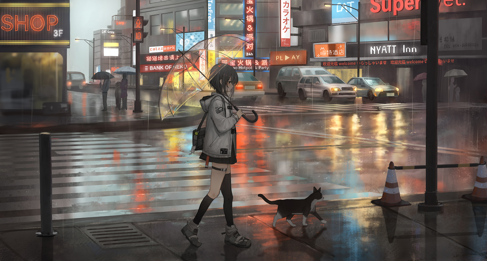

  

## 
💻 About Me

  Hi! I'm Oleh, a 14-year-old student and developer from Rivne, Ukraine. 
  Currently deeply focused on mastering technical foundations and modern web development. 
  Striving to write clean, efficient, and well-structured code under the hood.

  
  
  
  
  
  
  

---

## 
📽️ Featured Projects

  <a href="https://github.com/Oleh-Koliadiuk/After-Credits"><kbd>🎬 After-Credits</kbd></a> — Personal anime archive application for tracking watch history, ratings, and custom notes.  
  <a href="https://github.com/Oleh-Koliadiuk/Auto-Shorts-Generator"><kbd>🎬 Auto Shorts & Reels Generator</kbd></a> — Automated Python CLI pipeline for generating short-form vertical videos with AI subtitling.  
  <a href="https://github.com/Oleh-Koliadiuk/Personal-Portfolio-Remake"><kbd>🌐 Personal Portfolio Remake</kbd></a> — Refreshed version of personal portfolio with cleaner design and smooth interactions.  
  <a href="https://github.com/Oleh-Koliadiuk/Personal-Portfolio"><kbd>💼 Personal Portfolio</kbd></a> — Personal portfolio website showcasing projects, technical stack, and web development experience.

---

## 
📇 Contact Me

  
  
  

  <i>"Code is never finished. It only becomes slightly less terrible over time."</i>

